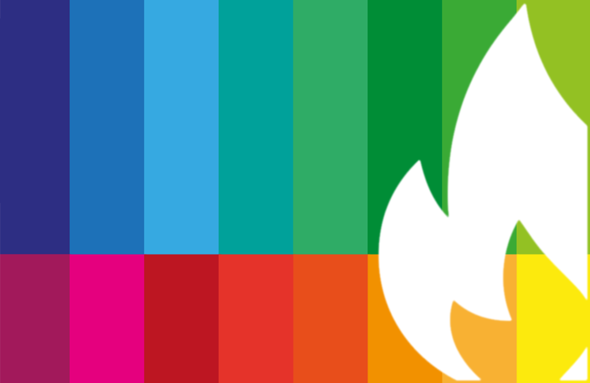

# Collaborative Project

Lena Gieseke | l.gieseke@filmuniversitaet.de  

---
* [Your Project](#your-project)
* [Setup](#setup)
    * [Budget and Material Costs](#budget-and-material-costs)
* [Group Work](#group-work)
* [Presentations](#presentations)
* [Final Submission](#final-submission)
    * [Project Documentation](#project-documentation)
* [Exhibit](#exhibit)
* [Grading](#grading)
* [Tipps From Last Year's Students](#tipps-from-last-years-students)
* [Policies](#policies)
* [Inclusivity Statement](#inclusivity-statement)
* [Stress Culture](#stress-culture)
---

In this class, you will develop and realize a digital media project on a given topic.  

The focus is on **creating one shared project as a group**. For this specific experience, everyone is encouraged to set aside individual interests and learning goals to fully engage in the collaborative process.

# Topic ***Who Told You That?***

**Society is shaped by the stories we tell and the stories we choose to listen to.**

> For the 56th edition of Sehsüchte, we want to challenge the regressive narratives that have once again grown louder, as well as rigid notions of society and self. Who gets to decide how we are supposed to imagine living together?
  
> Every social order, every norm, and every idea of how we want to live has been told - and can be told anew. **Who Told You That?** urges to reflect on the status quo. At the same time, it is an encouragement to question, to listen, and to give space to alternative perspectives and new visions of a diverse and solidaristic community.
  
> **For us, Sehsüchte as a festival space means taking the power of stories seriously.** It means bringing the diversity of perspectives that films offer to life through cinema, music, talks, and workshops. Because our world is what we make of it - what we dare to imagine and hope for.
  
  
You are free to interpret the topic in any direction you want. 

## Your Project

* The goal of this class is to exhibit a finished project.
* The final project must be part of the Sehsüchte festival 2027 (21. - 25. April 2027). However, the project itself must be finished by the end of February.
    * If your intended form of exhibition for the project is not possible during the Sehsüchte, please get in touch with me and we find a different exhibition space. However, the project must still be part of the Sehsüchte in some form.
* You work together as a class on this project.
    * The project must be a cohesive whole but can consist of different parts or can be a collection of pieces.
* You are free in choosing a format for the project, it can be in analog space, online or be a hybrid.
    * The previous years were quite similar. This is a coincident. Feel free to do something completely different.
* The project must refer to the topic in some form.

## Setup

* The exhibition of the project must be organized in its entirety by you. 
* The workshop regarding the Sehsüchte exhibition will also provide information valuable to the collaborative project. Make sure that you all attend the workshops with Arthur.
* Please keep in mind that there might be strict constraints for analog setups such as installations due to e.g. safety regulations.

### Budget and Material Costs

* You have up to 1000 EUR available for materials. 
* The budget is given out on a "needs basis", meaning there must be clear reasons for spending it.
* There are strict rules regarding what can be purchased and how money must be spent. If these rules are not followed, your expenses may not be reimbursed.

Process (TO BE CONFIRMED BY LENA)

1. Prepare a project description and one detailed purchase list.
    * The list should be structured by categories and include detailed item descriptions, quantities, and net costs per item.
    * Example:
        * Category "Wood to build support structure"
            * 10 × 5 m oak panels, 10 EUR each → 100 EUR total
            * 2 × 1 m oak panels, 5 EUR each → 10 EUR total
    * Lena will try to have the faculty approve only the overall categories, allowing some flexibility for adjustments during the project.
    * However, to be safe, check all changes with Lena before making them.
2. Lena reviews and approves the budget list.
3. Lena submits the approved list to the faculty.
    * Only after the faculty has officially approved the budget plan can you start purchasing materials.
    * The faculty will specify rules for the purchasing process, which you must follow exactly.
4. Allow approximately eight weeks from submitting your budget plan to Lena until you receive the faculty’s final approval.

General Rules (these might be expanded on by the faculty)

* Only one person should be responsible for the communication with Lena and the faculty.
* Ideally you buy things with an invoice to the Filmuni. The invoice must be addressed to the Filmuni and include the given BN (Beschaffungsnummer).
* In case you are allowed to make purchases yourself (this is to be seen), you must keep the invoice and a proof of payment for virtual payments (e.g. a screenshot of you account showing the money transfer).

## Group Work

* You are completely free to organize yourselves.
    * Not everyone has to have a creative / artistic output, tasks can also be project management, building a tool needed for production, or managing the advertisement and documentation. 
    * You will need to report on your tasks individually after the project.
* It is your responsibility to scale your tasks and workload to the requirements, including a documentation of the project.
    * Required work load per person: 150h work hours (5 ECTS from CTech II)
    * If you have a great idea and want to invest more time, we can give you more ECTS as electives. This needs to be discussed in advance.
* Rooms
    * Project week: you also have booked room 7318 for you from 30.11.-04.12.2026 throughout.
        * Attendance is not mandatory. It is up to you as a group to decide how you want to make use of this.
        * Please let us know if you are not using the room.
    * If you want an additional room, e.g., weekly, please get in touch with Lena.

## Presentations

* Project pitch: 02.12.2026 upload in Github
    * If you have difficulties with finalizing this, you can schedule a session with Lena
* Roles and concept: 02.12.2026 in P&R (max. 45 min)
* Finalized concept, prototype, execution plan: 27.01.2027 in P&R (max. 45 min)

You must upload all presentation materials after each presentation.

## Final Submission

The exhibition piece itself must be completed by **February 26th 2027**.  
  
We can book for you the 6119 for a certain time (e.g., 2 weeks) before the deadline. For that get in touch with Eva and me early so that we can make the booking. 
  
If you need me to see the exhibition piece live, make sure to schedule a date for that with me **early on** (it must before February 26th).

The submission consists of two parts:

1. as a group, one common project documentation,
2. individually a documentation of your tasks and responsibilities.

### Project Documentation

The common project documentation must include:

* A link to a **polished website** with a documentation of your project meant for the general public
    * The webpage can be simple, e.g., it can be a GitHub page but the standard github or notion interface is not enough.
* Your results must be fully understandable based on this page (e.g. to someone who knows nothing about your project)
* You are free to design this page, but you must cover the following points:
    * Title
    * Description of the content and its technical implementation
    * Context, related work
    * Your results, at least with
        * a descriptive text,
        * two representative images
        * one video
    * Discussion of your results
    * Next steps, future work
    * "Handover to the next collaborative project"
        * Document everything that you would like the next year to know, anything that might make their life easier
        * This can be on a separate page

You are free to add any additional information or reflections.

## Exhibit

The final requirement to complete the collaborative project is the exhibition of your work during Sehsüchte 2027. However, all documentation, etc., must be completed by February 26th. The grades will be based on the version on February 26th.

Again, if you spend a lot of additional time for exhibiting your project during Sehsüchte, you can get additional points, if you clarify it in advance with me. By default, however, you should plan in the time for setting up the exhibition during Sehsüchte within the 5 ECTS.

## Grading

There will be individual grades. Each grade is the sum of

* the project development (5%)
* the final project (55%)
* and your individual tasks (25%)
* the Sehsüchte exhibition (15%)

We base the grading mainly on the documentations and presentations, but we will also consider what we perceive along the way. For passing the project you must be involved in both, the project and its Sehsüchte exhibition setup.

The grade for the project development and final project will be the same for all. The common grade will be based on

* the group work and organization,
* the concept,
* the creative use of soft- and hardware,
* the cohesiveness of the project, 
* the execution of the project, and
* the documentation of the work.

An individual grade will be given for

* the quality and quantity of your individual tasks
* your involvement in setting up the Sehsüchte exhibit of the project
* your personal influence on the results (if applicable)

## Tipps From Last Year's Students

[https://half-spruce-004.notion.site/Final-Documentation-2ff46930f083805cb3fcccc97d576eaf](https://half-spruce-004.notion.site/Final-Documentation-2ff46930f083805cb3fcccc97d576eaf)  
(Note: this year a notion.site is not sufficient and project webpage)  

- Using both Notion and Discord worked really well for us and is a setup we would definitely recommend to future teams.
- The way we conducted the project pitch was effective and helped keep it concise, preventing it from running too long.
- Even with different assigned roles, it’s important that major project decisions are discussed with everyone or at least communicated clearly. Lack of communication can create stress or feelings of exclusion.
- Establish a code word for signaling difficult moments or disagreements. Even if it feels a bit silly, it helps diffuse tension. Also, be open with your team about personal challenges or difficult days and support each other. Avoid ghosting or passive-aggressive behavior, as it can undermine team cohesion.
- Make sure to have a finished prototype ready at least a few days before the final presentation to allow time for testing and last-minute adjustments.

## Policies
 
* **Tools and utilities**: You are allowed to use any tools you want, but you are required to list and briefly describe the usage of such tools in your submission. 
* **External collaborators**: You are allowed to work with external people on the project and to outsource certain tasks. You are responsible to make these collaborations work and for all results. You are required to clearly document in your submission what is done by whom.

## Inclusivity Statement

All students should be served by this course. Please view the diversity that you bring to this project as a resource, strength and benefit.  

It is your responsible to set up a desirable work culture. However, I will not tolerate discrimination or harassment, i.e. a pattern of behavior directed against a particular individual with the intent of humiliating or intimidating. If I perceive any form of such behavior, I will interfere in your project.

## Stress Culture

This class is very demanding as you not only further develop your skills but you also have to organize yourselves in a group and produce a polished result in the end. This is hard (and is meant to be hard).
  
However, please take care of yourself. Communicate, carefully manage your expectations and properly plan you processes.  

All of us benefit from support during times of struggle. You are not alone. There are many helpful resources available at Filmuni, and an important part of the university experience is learning how to ask for help. If you or anyone you know experiences any unbearable stress, difficult life events, or feelings like anxiety or depression, I strongly encourage you to seek support. You can get in touch with me, or directly with the Filmuni offerings of different [services and counseling](https://www.filmuniversitaet.de/en/university/counseling-services). 

[*Adapted from P. Pedercini with permission.*]